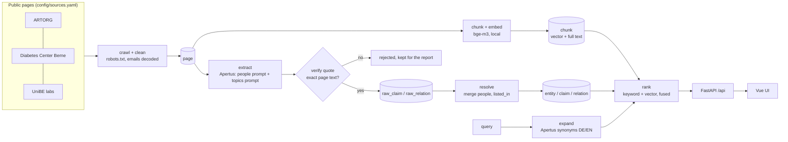

# Research & Expertise Navigator

Find researchers, units, projects and infrastructure in the Bern research ecosystem, with every fact
linked to a quote on a public page. The build plan is in [`docs/PLAN.md`](docs/PLAN.md).

## How it works



- **Every fact is a literal slice of a public page.** The extractor must return a quote for each fact. The
  quote is matched against the stored page text and saved as the exact page text, or the fact is rejected
  (13% of extracted facts were rejected, including names the model made up).
- **Sovereign:** Apertus (Swiss open LLM) for extraction, query expansion and explanations; bge-m3 embeddings run
  locally; everything runs in Docker with no connection to cantonal networks.
- **Two models:** extraction runs on `apertus-v1-5-8b` (`EXTRACT_MODEL`), because 70B was slower and, on the
  same pages, not better (plan section 3); quote verification catches the small model's errors.

## Run with Docker

Everything runs in containers: Postgres, the Python pipeline and API, and the Vue UI. Nothing connects to
cantonal networks. The only outside calls are the crawled public sites and the Apertus gateway.

```bash
cp .env.example .env                                       # then set KEERA_API_KEY
docker compose up -d db                                    # Postgres 16 + pgvector
docker compose run --rm app uv run navigator ingest        # init-db → crawl → embed → extract → resolve → judge
docker compose up -d app frontend                          # API + UI
```

- UI: http://localhost:5173 · API docs: http://localhost:8000/docs
- `ingest` on 100 pages takes about 15–20 min. The first run also downloads bge-m3 (~2.3 GB) into the
  `hf_cache` volume. The app image is ~2 GB (CPU-only torch).
- Extraction uses `apertus-v1-5-8b` by default (`EXTRACT_MODEL`): 70B was slower and not better (plan section 3).
  `navigator llm-speed` shows the current gateway speed per model.
  Override with `EXTRACT_MODEL=apertus-v1-5-70b docker compose run ...`.
- Host ports can be changed with `DB_PORT`, `API_PORT` and `UI_PORT`, e.g. to run a second stack with its
  own data: `DB_PORT=55432 API_PORT=18000 UI_PORT=15173 docker compose -p navclean up -d`.
- Single steps also work in the container: `docker compose run --rm app uv run navigator <command>`.

## Local development setup

```bash
cp .env.example .env          # then set KEERA_API_KEY
docker compose up -d db       # Postgres 16 + pgvector
uv sync
uv run navigator init-db      # schema + sources from config/sources.yaml
```

## Pipeline

Run the steps in this order, for all sources or one source with `--source ID`:

```bash
uv run navigator ingest       # all of the steps below, in order
uv run navigator crawl        # crawl + clean pages into `page`
uv run navigator embed        # chunk + embed pages into `chunk` (bge-m3, ~2.3 GB download on first run)
uv run navigator extract      # Apertus extracts facts with quotes, quotes are verified, then resolve + judge
uv run navigator judge        # claim judge only (plan 7.8): does each quote support its fact?
uv run navigator stats        # pages, chunks, entities and claims per source
```

- `extract --url-like '%/aihn/group_members/%'` re-extracts single pages. `--no-resolve` skips resolve.
- `reverify` re-runs the verification rules on the stored extractions (no LLM calls, ~3 s), then resolves.
  Use it after changing a check.
- `resolve` rebuilds entities, claims and relations from the verified extractions.

**After every `crawl`, run `embed` again for the same source.** `crawl` replaces a source's pages, and
deleting a page also deletes its chunks, so a re-crawled source has no chunks and does not show up in
search until it is embedded again:

```bash
uv run navigator crawl --source dcb
uv run navigator embed --source dcb
```

**The claim judge runs last.** `extract`, `reverify` and `resolve` rebuild the claims and reset its
verdicts, so `extract` runs `judge` itself (`--no-judge` to skip, or `JUDGE_ENABLED=false`); after
`reverify` or `resolve`, run `uv run navigator judge`. Claims judged `unsupported` are hidden, and
`partial` ones carry a marker. `navigator stats` shows the verdict counts.

## Debugging search

```bash
uv run navigator search-chunks "continuous glucose monitoring" --k 10
uv run navigator search-chunks "Herzklappen" --expand   # add Apertus search terms (needs KEERA_API_KEY)
```

Prints the top chunks (keyword + semantic search, fused with RRF) with page URL and score.
With `--expand` it first prints the English and German search terms from Apertus.

## Evaluation

```bash
uv run navigator eval             # 9 gold queries (eval/gold.yaml) through the /api/search pipeline
uv run navigator eval --no-expand --no-judge  # no gateway needed
```

Prints the plan 10.2 metrics (recall@10, phrasing overlap, traceability, field fill, coverage, drop rate,
judged precision@10) and saves them to `eval/report.md`. The eval judge's verdicts and reasons go to
`eval/judge_log.jsonl` for spot checks. Re-run it after every change to extraction, resolve or ranking.

## Sharing the backend with a teammate

```bash
echo "API_TOKEN=$(openssl rand -hex 24)" >> .env
uv run navigator serve --host 0.0.0.0
```

The teammate runs only the frontend: `BACKEND_URL=http://<host-ip>:8000 BACKEND_TOKEN=<token> npm run dev`.
Details and caveats in [`docs/SHARED_SERVER.md`](docs/SHARED_SERVER.md).

## Add a new source

No code change: one block in `config/sources.yaml`, then ingest that source.

```yaml
  - id: insel
    name: "Example Institute"
    seeds: [https://www.example.unibe.ch/research/index_eng.html]
    allow_hosts: ["www.example.unibe.ch"]
    include_patterns: ['index_eng\.html$']
    exclude_patterns: ['/news', '/jobs/']
    priority_patterns: ['^https://www\.example\.unibe\.ch/research/[a-z0-9_]+/index_eng\.html$']
    max_pages: 30
```

```bash
docker compose run --rm app uv run navigator ingest --source insel
```

Keep `priority_patterns` narrow and anchored to the site root: they decide what the page budget is spent on.

## Data protection

- Only public pages of the listed institutions are used. Copyright stays with them.
- Only facts written on those pages are stored (names, roles, public contact data, research topics), each with
  its quote and source URL. Nothing is added from other places.
- A re-crawl replaces a source's pages, and everything extracted from them is deleted with them (database cascade).
- Every result card links to its source pages, so each fact can be checked at the source.
- Designed for the Swiss nDSG and the GDPR where it applies. No user accounts: feedback is stored with an
  anonymous session id. Its optional free-text comment is stored as typed, so it should not ask for personal data.

## Tests

```bash
uv run pytest -q              # database tests are skipped when Postgres is not running
```
