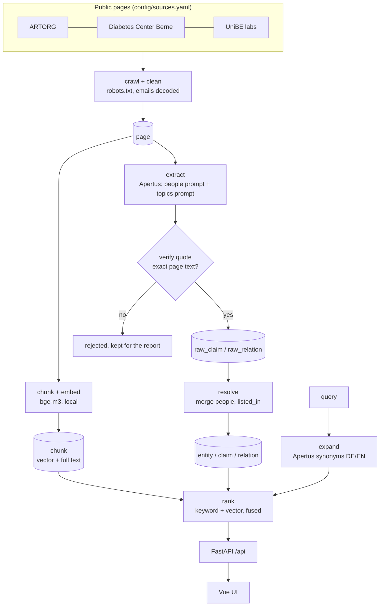

# Research & Expertise Navigator: technical report

HackApertus 2026, challenge "Research & Expertise Navigator". Code: github.com/Grozby/kinder-bueno. Numbers
from the eval run of 2026-10-18 on main `ad33a2a` (`eval/report.md`, `eval/case_report.md`), on the 100-page demo database.

## 1. Problem and approach

Expertise in Bern is spread over hundreds of faculty, institute, lab and centre pages, and people search with
other words than the sites use ("glucose sensors" for "continuous glucose monitoring"). The Navigator crawls the
public pages of ARTORG, the Diabetes Center Berne (DCB) and UniBE labs, turns them into people, units, projects
and infrastructure, and makes them searchable in German and English. Every fact it shows is a quote from a
public page, with the link to that page.

On top of the search sits a **case board** for location promotion:

1. A company's business model PDF is uploaded.
2. Apertus reads its research needs (up to 6).
3. Each need goes through the search; a cross-encoder checks which verified topic claims serve which need.
4. The case gets a fit score from five fixed criteria (research fit, the share of needs covered, weighs 40%) and
   up to 25 sourced references: people, units, projects and infrastructure.
5. The reviewer refines the references by chat, moves the card through the board, adds a review and notes, and
   gets a pitch, a partner report (.docx) and slides (.pptx). Every sentence of generated text cites the
   claims it is built on, and a citation outside the shown references is rejected.

## 2. Architecture

**Ingest** (`navigator ingest`, one command, or the steps on their own):

- **Crawl and clean.** Seeds, allowed hosts and include, exclude and priority patterns per source, all in
  `config/sources.yaml`. robots.txt is respected, obfuscated e-mail addresses are decoded and navigation is
  stripped. Crawl rules can be edited in the UI and a source re-crawled from there.
- **Chunk and embed.** bge-m3 (1,024 dimensions, multilingual), run locally. Chunks are stored with their vector
  (HNSW index, cosine) and a full-text column (GIN index).
- **Extract.** Apertus 8B with two prompts per page part: people (name, role, unit, contact) and topics (unit
  expertise, projects, infrastructure). Each fact comes with a quote.
- **Verify.** The quote is matched against the stored page text. A match is saved as the exact page text; no
  match rejects the fact (section 3).
- **Resolve.** Mentions become entities by exact normalised name (titles such as "Prof. Dr." stripped), and people
  are linked to their lab from member pages (`listed_in`). There is no fuzzy matching on purpose: a few
  duplicates are acceptable, a wrong merge of two people is not.
- **Judge** [PoC]. A second Apertus call checks whether each quote supports its fact. Facts judged
  `unsupported` are hidden; `partial` ones carry a marker.

**Search** (`GET /api/search`, the chat and the case analysis use the same ranking):

1. Apertus expands the query into German and English terms (cached per process).
2. Keyword search (Postgres full text) and vector search over chunks, fused with reciprocal rank fusion.
3. Entities are scored from the shown claims on the hit pages (IDF-weighted), plus a bonus for entities whose
   own topic claims match the query. People inherit half of their unit's score, heads and professors get a boost,
   and a fairness cap allows at most 3 results per unit.
4. Below a similarity of 0.50, with no keyword hit, the answer is "no reliable result" instead of weak hits.
5. Apertus writes a one-sentence "why it matches" per result, citing only that result's shown claims.

**Chat** (`/api/chat`): a LangGraph agent with four tools (search, filters, "more like #N", "who works
with #N"), at most 3 rounds, with a plain-search fallback and a reply check against the shown results.

**Stack.** Python 3.12 (FastAPI, psycopg, sentence-transformers), Postgres 16 with pgvector, Vue 3. Docker
Compose: `db`, `app` (API and pipeline), `frontend`. The handoff layout (`docker-compose.handoff.yml`) serves the
built UI from nginx, which proxies `/api` and publishes only `127.0.0.1:8080`. CI runs the tests, linting and
frontend build on every pull request.

## 3. The traceability guarantee

Every fact shown is a literal slice of a public page.

- Apertus must return a quote for each fact. The quote is matched against the stored page text and saved as the
  exact text found there. If it is not found, the fact is rejected.
- **13% of extracted facts were rejected (221 of 1,705).** Among them: people the model made up from the
  prompt example, invented entity names, author abbreviations and list labels such as "Alumni".
- **Traceability: 100%** of displayed facts in the eval are verified, not judged unsupported, and link to their
  source page.
- Claim judge [PoC] on 558 verified topic claims: 403 supported, 123 partial, 32 unsupported (hidden).
- Generated text (why it matches, chat answers, pitch, partner report) cites facts by claim id. A sentence
  that cites no claim, or a claim that is not shown with that result, is dropped and replaced by a fixed template
  built from the shown claims.

## 4. Results

Gold set: 3 use cases (glucose monitoring, computer-assisted surgery, cardiovascular engineering), each with
three phrasings (site wording, lay term, synonym) and 5–7 expected entities. 9 queries, 100 crawled pages.

| Metric | Result | Target |
|---|---|---|
| recall@10 | **64%** | 80% |
| recall@10, lay-term and synonym phrasings | **67%** | 80% |
| traceability of displayed facts | **100%** | 100% |
| phrasing overlap (Jaccard of top-10 sets): glucose, surgery, cardio | 60%, 41%, 48% | report |
| field fill, people: role, affiliation, lab topics | 100%, 100%, 98% | report |
| field fill, people: personal expertise | 0% | report |
| judged precision@10 [PoC] | 49% | report |
| eval judge agreement with the gold hits [PoC] | 61% (19 of 31) | report |
| extraction drop rate (quote not found) | 13% (221 of 1,705) | report |

- **Recall rose from 14% to 64%** through ranking work: IDF on claims, owner of a page section, topic match,
  fairness cap, inheritance and seniority (`docs/PLAN.md` 10.2). It is best on cardio (80–100%) and weakest on
  surgery (29–43%): the head of the image-guided therapy chair appears in the 100 pages only as a lecturer.
- **Personal expertise is 0%** because the crawled pages state topics for labs, not for people. People show
  their lab's topics, labelled as the lab's.
- **Judged precision fell from 60% to 49%** with the last ranking change (#130), which raised recall from 60%
  to 64%. 77 of the 88 judged results were the same as in the run before; on those, the judge changed 9
  verdicts, 7 of them to "not relevant" (for example "Chair for Image-guided Therapy" for "surgical robots").
  Of the 11 new results, it judged 2 relevant, against 5 of the 9 that left. The judge rates all 10 results of a
  query in one call at temperature 0: on identical input it is deterministic (0 of 87 verdicts differ over three
  runs), but the same results in reverse order change 14 of 86 verdicts. A ranking change therefore also changes
  verdicts on results that stayed. The judge uses the extractor's model family and agrees with the human gold set
  on only 61% of gold hits, so it is a signal, not a measurement.

**Case eval** (4 fictional business models in `docs/examples`, expected matches in `eval/cases.yaml`):

| Case | Score | Expected range | Expected matches found | False matches |
|---|---|---|---|---|
| Glucora (wearable glucose sensor) | 77 | 55–90 | 8 of 11 | 0 |
| Repolar | 64 | 55–90 | 3 of 9 | 1 |
| Precisa | 67 | 55–90 | 7 of 11 | 2 |
| Vinora (no research fit) | 0 | 0–30 | – | 0 |

All four scores are in range; 18 of 31 expected matches are found (20 of 31 among the references), with 3 false
matches. A live upload reads the PDF afresh, and the Glucora score varied between 55 and 80 across rehearsals,
because the needs Apertus reads change.

## 5. How it scales

**Pages.** Going from 100 to ~2,000 pages is a change in `config/sources.yaml`, not in code. A deeper crawl
with person profile pages (#75) was run:

| | Demo database | Deeper crawl |
|---|---|---|
| pages | 100 | 340 (48 ARTORG profiles, 103 UniBE labs) |
| chunks | 377 | 773 |
| entities | 537 | 1,339 |
| claims | 1,567 | 5,336 |
| recall@10 / lay-term | 64% / 67% | 62% / 66% |
| people with their own expertise | 0% | 26% |

The deeper crawl is not used for the demo yet: more labs compete for the top 10, and it is still a few points
behind. Fixing the resolver duplicates it showed (the same person with and without "Ass. Prof.", "Neuro
Robotic(s) Group") raised it from 58% / 61% to 62% / 66%, with the demo database unchanged. It is swapped in only
once it is at least level, measured with the same gold set.

**Measured times per step** (100 pages, about 3,200 characters of text per page):

| Step | Time | Notes |
|---|---|---|
| embed | ~20 s for 377 chunks | bge-m3 on a laptop CPU |
| extract, Apertus 8B | ~10 min | 120–160 tokens/s, 8 requests in parallel |
| extract, Apertus 70B | ~15 min | 52 tokens/s; not better on the same pages (43% vs 46% recall, 46% vs 63% precision) |
| claim judge | ~2.4 min | 96 pages |
| whole `ingest` | 15–20 min | most of it Apertus |

Crawl, clean and resolve were not timed on their own; they are small next to extraction. Extraction scales with
the amount of page text and the gateway throughput. As an extrapolation from the measured run, not a
measurement: 1,000 pages of the same size take about 100 minutes of 8B extraction at the same throughput.
Token cost per page was not recorded. `navigator llm-speed` measures the gateway's current speed per model
before a large run.

**Search latency.** A whole search takes about 3–4 s; ranking is about 1 s of it in Docker (it was 6.9 s
before the topic vectors were cached), the rest is query expansion (1.3–2.1 s) and the "why" sentences, which
run in parallel. A cross-encoder rerank of the top chunks would add 6.7 s for 20 chunks on the Docker CPU for
+1 to +5 recall points, so it is not enabled; on a GPU it would take a fraction of that. The chunk table uses an
HNSW index (cosine). At the measured 2–4 chunks per page, ~2,000 pages give roughly 4,000–8,000 chunks, a small
size for HNSW. Beyond ~100,000 chunks, the index build parameters and `ef_search` would need tuning. Search
latency against chunk count was not measured.

**CPU or GPU.** bge-m3 and the case reranker run on CPU (CPU-only torch, ~2 GB image). Embedding 377 chunks
takes ~20 s and a case analysis 25–60 s, most of it Apertus. A GPU pays off when re-embedding thousands of pages
often, or to enable the chunk rerank in search.

**Concurrency.** Chats, case state and the ingest lock are in Postgres (#103), so the API runs with several
workers (`navigator serve --workers N`, ~3 GB RAM each) or replicas on one database. A case analysis or ingest
runs in the worker that started it; if that worker dies, the source shows "interrupted" and the analysis stays
"pending" until the PDF is uploaded again.

**New sources and other domains.** A new site is one block in `config/sources.yaml` (seeds, allowed hosts,
patterns, page budget), then `navigator ingest --source <id>`. The pipeline is not specific to research: the same
crawl, quote-verified extraction and sourced search can serve location reports for companies settling in Canton
Bern (suppliers, manufacturers, advisors), with a different extraction prompt and entity types.

## 6. Operations and sovereignty

- **Hosting:** Docker Compose 2.24 or later, 8 GB of RAM for Docker, ~12 GB of disk (images ~3 GB, models
  ~4.5 GB, the database). Build ~5–10 min; the API is healthy ~1 min after start. Setup in `HANDOFF.md`, or
  `scripts/demo.sh setup` in one command.
- **Models:** Apertus (the Swiss open LLM) through the Keera gateway, the only outside connection besides the
  crawled public sites. bge-m3 and the reranker run locally. No connection to cantonal networks.
- **Data protection:** only public pages of the listed institutions; only facts written there, each with its
  quote and source URL; a re-crawl replaces a source's pages and deletes everything extracted from them.
  Uploaded PDFs are company data: only their text is stored, and it is sent only to the Apertus gateway.
  Designed for the Swiss nDSG and, where it applies, the GDPR. No user accounts.
- **Backups:** `pg_dump -Fc` of the database (`scripts/demo.sh dump`); restore replaces the whole database. The
  crawled data is rebuilt from the sources with `navigator ingest`.

## 7. Limits and roadmap

- **Recall is 64%, short of the 80% target.** The lever left is data: profile and facility pages (#75), with
  which is now close to the demo database (62% against 64%). Ranking constants were swept and are near their best on this gold set (#99).
- **The gold set is small:** 9 queries in 3 use cases. A difference of ±2 points is noise.
- **The LLM judge is a proof of concept:** 61–73% agreement with the gold set, and its verdicts depend on the
  order of the results it is shown (16% change when the order is reversed). Judging each result on its own would
  remove that, at 10 times the calls.
- **Personal expertise** needs profile pages (#75).
- **Open:** deleting a case and its data (#134), documentation updates (#100, #104), published Docker images
  (#101).
- **Done since the first demo:** crawl rules and re-crawl from the UI (#79, #80, #105), persisted cases with
  review, notes and similar cases (#81, #108), partner report and slides (#96), chat agent (#97),
  multi-worker API (#103), CI (#101).
